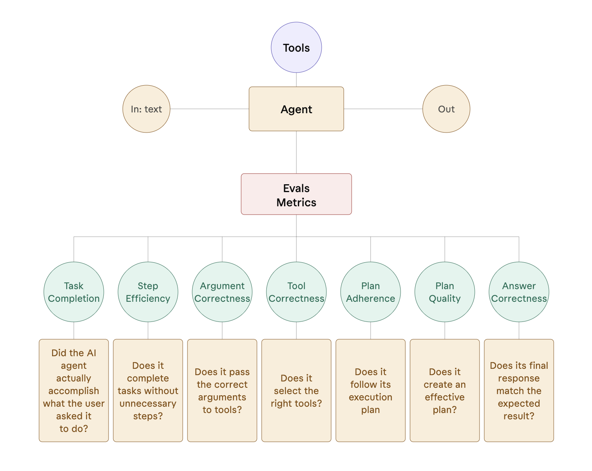
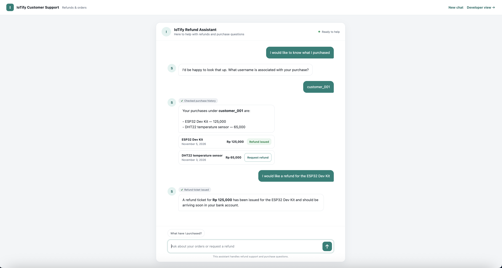
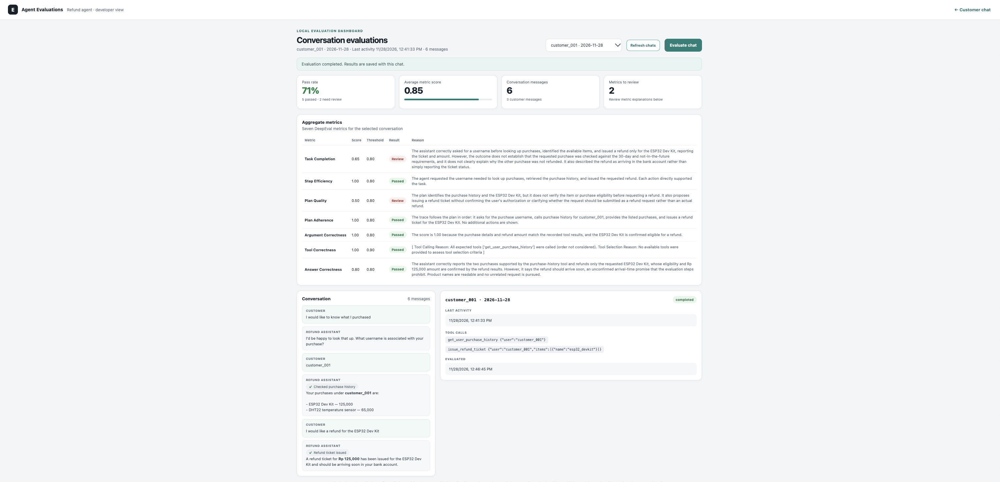
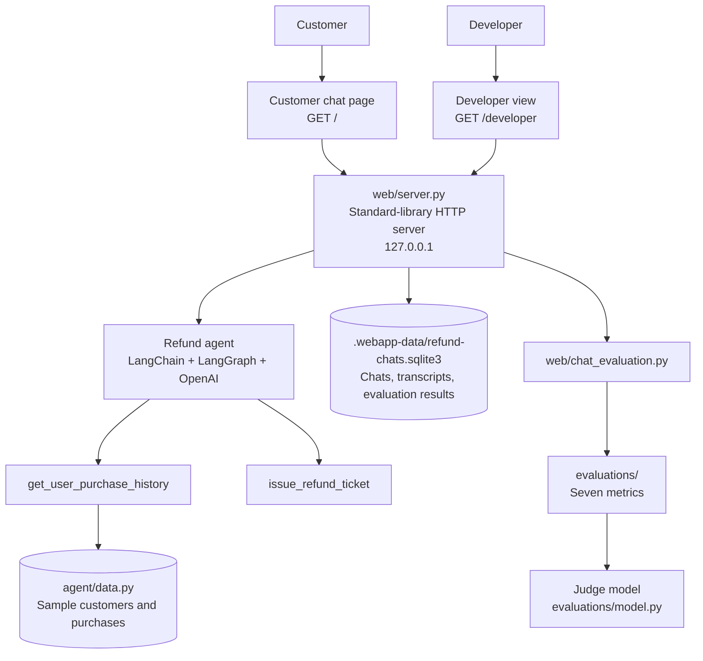

# 🧾 IoTify Refund Assistant | Agent + Evaluation Dashboard

> A customer-support agent for refund requests and purchase questions, with a customer-facing web chat and a developer view that scores any saved conversation on seven agent-evaluation metrics.

**Stack:** Python · LangChain · LangGraph · OpenAI chat models · DeepEval · Python standard-library HTTP server · SQLite · HTML / CSS / JavaScript



> [!IMPORTANT]
> This is a demonstration project. Refund tickets are **simulated** by a local tool. The app is not connected to a real bank, payment processor, or order-management system, and the sample customers and purchases in `agent/data.py` are fictional.

---

## Table of Contents

- [1. Problem Statement](#1-problem-statement)
- [2. Proposed Solution](#2-proposed-solution)
- [3. System Architecture](#3-system-architecture)
- [4. How the Agent Behaves](#4-how-the-agent-behaves)
- [5. Evaluation Metrics](#5-evaluation-metrics)
- [6. Technology Stack](#6-technology-stack)
- [7. Project Structure](#7-project-structure)
- [8. Setup and Installation](#8-setup-and-installation)
- [9. Running the Web App](#9-running-the-web-app)
- [10. Running the Tests](#10-running-the-tests)
- [11. Running the Evaluations](#11-running-the-evaluations)
- [12. Local Data and Privacy](#12-local-data-and-privacy)
- [13. Limitations](#13-limitations)
- [14. License](#14-license)

---

## 1. Problem Statement

Refund conversations look simple but are easy for an AI agent to get wrong. The agent has to identify the customer, look up purchase records, apply a policy, and only then act. A fluent reply can hide a wrong tool call or a refund for the wrong item.

| Problem | Description |
|---|---|
| **Policy errors** | Refunding outside the 30-day window, or an item that was never bought. |
| **Wrong actions** | Issuing a ticket for items the customer did not select. |
| **Hard-to-inspect behavior** | A good-sounding answer says little about whether the right tools were called with the right arguments. |
| **No feedback loop** | Without repeatable evaluations, prompt or tool changes cannot be compared. |

### Core Challenge

> How can we build a refund agent that follows policy, and give developers a way to measure, per conversation and per metric, whether it actually did?

---

## 2. Proposed Solution

Two pages on top of one agent:

1. **Customer chat (`/`).** A customer talks to the refund assistant.
2. **Developer view (`/developer`).** A developer selects a saved conversation and evaluates it on seven metrics.

Underneath, a golden evaluation dataset and standalone scripts let you run the same metrics outside the web app.

### Screenshots

| Customer chat | Developer view |
|---|---|
|  |  |

### Features

- 💬 Customer chat for refund requests and purchase questions
- 🔎 Purchase lookup by username
- 🗓️ 30-day eligibility check against the purchase date
- 🎫 Simulated refund tickets for only the items the customer selected and purchased
- 🧭 Redirects unrelated requests back to refunds and purchases
- 🏷️ Readable product names in customer-facing replies, not raw underscore-separated identifiers
- 🗂️ Saved chats with titles built from the identified username and last-activity date (or **Unknown user**)
- 📊 Seven-metric evaluation of any saved conversation
- 🧪 Golden dataset plus individual and combined evaluation scripts
- ✅ `unittest` tests for chat evaluation, storage, and item-name formatting

---

## 3. System Architecture



---

## 4. How the Agent Behaves

The agent has two tools:

| Tool | Purpose |
|---|---|
| `get_user_purchase_history` | Looks up a customer's purchases by username from the sample data in `agent/data.py`. |
| `issue_refund_ticket` | Checks item eligibility and creates a **simulated** refund ticket. No money moves. |

`agent/tools.py` also defines `calculate_right_refund`. It is **not registered** with the active agent, so the agent cannot call it.

Behavior rules:

1. **A username is required** before any lookup. If the customer has not given one, the agent asks.
2. **Eligibility is checked** against the purchase date and the **30-day** window.
3. **Only selected, purchased, eligible items receive a ticket.** The agent does not process items the customer did not choose or items that are not in their history; the tool enforces the date policy.
4. **Purchase questions** (what was bought, when) are answered from the lookup.
5. **Unrelated requests** are politely redirected.
6. **Product names are shown in readable form** to customers.

The agent introduces itself as the **IoTify Refund Assistant**. Its instructions are in `agent/prompts.py`. Both the agent and the DeepEval judge model are currently configured as `gpt-6-luna`; check `agent/agent.py` and `evaluations/model.py` if you change either model.

The Plan Quality and Plan Adherence metrics use the recorded conversation and tool activity. They do not inspect hidden model reasoning.

---

## 5. Evaluation Metrics

The developer view and the scripts in `evaluations/` score a conversation on seven metrics. Evaluation uses the **recorded conversation and tool activity**. It does not expose hidden model reasoning.

| Metric | Question it answers |
|---|---|
| **Task Completion** | Did the agent actually accomplish what the user asked it to do? |
| **Step Efficiency** | Did it complete the task without unnecessary steps? |
| **Plan Quality** | Was the observable action sequence appropriate for the task? |
| **Plan Adherence** | Did its recorded actions follow the task requirements? |
| **Argument Correctness** | Did it pass the correct arguments to its tools? |
| **Tool Correctness** | Did it select the right tools? |
| **Answer Correctness** | Is its response consistent with the conversation, policy, and tool results? |

> [!WARNING]
> Evaluations call the configured **judge model**, so they use your API key and **may incur charges**. Evaluate a few conversations first to estimate cost.

---

## 6. Technology Stack

| Component | Technology | Purpose |
|---|---|---|
| Agent runtime | Python, LangChain's agent API, LangGraph in-memory checkpointer | Runs the tool-calling refund agent and keeps its conversation state in memory while the server is running |
| Chat model | `langchain_openai.ChatOpenAI` | Chat model for the agent, configured in `agent/agent.py` |
| Agent tools | `get_user_purchase_history`, `issue_refund_ticket` (`agent/tools.py`) | The first reads the sample customer data; the second checks item eligibility and **simulates** a refund ticket. No real payment system is involved |
| Data and schemas | Sample records in `agent/data.py`, Pydantic models in `agent/objects.py` | Fictional customer purchase records and typed objects. This is sample data, not a production database |
| Evaluation | DeepEval, seven metrics, golden dataset, custom judge model | Scores conversations. Evaluations make model API calls and **may incur costs** |
| Web backend | Python standard-library `ThreadingHTTPServer`, local SQLite | Serves the pages and endpoints on `127.0.0.1` and stores chats, transcripts, and evaluation results. It is not Flask or FastAPI |
| Frontend | Static HTML, CSS, and vanilla JavaScript in `web/static/` | Customer chat and developer view. No frontend framework or build step |
| Configuration | `python-dotenv` | Loads local settings (such as the OpenAI API key) from `.env` |
| Tests | Python `unittest` under `tests/` | Tests for the web layer helpers |

The repository does not pin dependency versions in a package manifest. The model names above are the values currently configured in source, not a promise that those models are available to every OpenAI account.

---

## 7. Project Structure

```text
.
├── agent/
│   ├── agent.py              # Agent construction and configured model
│   ├── data.py               # Sample customers and purchases (fictional)
│   ├── models.py
│   ├── objects.py
│   ├── prompts.py            # Agent prompts
│   └── tools.py              # get_user_purchase_history, issue_refund_ticket
│
├── docs/
│   └── agent_evals_metrics_map.jpg
│
├── evaluations/
│   ├── all_evaluation.py     # Runs every metric together
│   ├── answer_correctness.py
│   ├── argument_correctness.py
│   ├── dataset.py            # Golden evaluation dataset
│   ├── model.py              # Judge model configuration
│   ├── plan_adherence.py
│   ├── plan_quality.py
│   ├── step_efficiency.py
│   ├── task_completion.py
│   └── tool_correctness.py
│
├── tests/
│   ├── test_chat_evaluation.py
│   ├── test_chat_storage.py
│   └── test_item_names.py
│
├── .deepeval/                # Tracked DeepEval result artifacts
│   ├── .latest_run_full.json
│   └── .latest_test_run.json
│
├── ui-assets/
│   ├── customer-chat.png
│   └── developer-view.png
│
├── web/
│   ├── static/               # Customer and developer front end
│   ├── chat_evaluation.py    # Runs evaluations on saved chats
│   ├── chat_storage.py       # SQLite persistence for chats
│   └── server.py             # HTTP server and routes
│
├── .gitignore
├── LICENSE
└── README.md
```

The web app creates `.webapp-data/` at runtime for its local SQLite database; this directory is ignored by Git. The `.deepeval/` result files shown above are currently tracked.

---

## 8. Setup and Installation

### Prerequisites

- Python 3.10 or later (the project has been run with Python 3.11.18)
- An [OpenAI](https://platform.openai.com/) API key

### Step 1: Clone the repository

```bash
git clone <your-repository-url>
cd <repository-folder>
```

### Step 2: Create a virtual environment

```bash
python -m venv .venv
source .venv/bin/activate        # Windows: .venv\Scripts\activate
```

### Step 3: Install dependencies

The repository currently has **no `requirements.txt` or `pyproject.toml`**, so dependency versions are not pinned. The code directly imports these packages:

```bash
pip install langchain langchain-core langchain-openai langgraph deepeval python-dotenv pydantic
```

> [!NOTE]
> This installs unpinned package versions; dependency compatibility may change over time. The project does not currently provide a reproducible lockfile.

### Step 4: Configure environment variables

The project uses `python-dotenv` to load local settings. For local use, put your OpenAI API key in an untracked `.env` file in the project root. The example below is a placeholder; never put a real key in this README or commit it:

```dotenv
OPENAI_API_KEY=your_openai_api_key_here
```

> [!WARNING]
> **Security notes**
>
> - Never commit `.env`; it is listed in `.gitignore`.
> - Never paste real API keys into documentation, screenshots, or chat. If a key has ever been exposed, rotate it immediately.
> - `.webapp-data/` is also ignored by Git because it stores conversation transcripts.

---

## 9. Running the Web App

```bash
python web/server.py
```

The server binds to **127.0.0.1**, so it is reachable only from your own machine.

The default port is `8000`. You can choose a different port with the `--port` option or the `PORT` environment variable:

```bash
python web/server.py --port 8001
# Or:
PORT=8001 python web/server.py
```

| Page | URL |
|---|---|
| Customer chat | `http://127.0.0.1:<port>/` |
| Developer view | `http://127.0.0.1:<port>/developer` |

The main chat API routes are:

| Method | Route | Purpose |
|---|---|---|
| `POST` | `/api/chat` | Send a customer message to the refund agent |
| `GET` | `/api/chats` | List saved conversations |
| `POST` | `/api/chats` | Create a new conversation |
| `GET` | `/api/chats/{chat_id}` | Load one conversation |
| `POST` | `/api/chats/{chat_id}/evaluate` | Start a background evaluation for a saved conversation |

These are API endpoints, not additional pages.

### Try it

1. Open the customer chat and say you want a refund.
2. Give a username from `agent/data.py` when asked.
3. If you have not named an item, choose from the purchases the assistant finds. If you already named a purchased item, the assistant can proceed without asking you to select it again.
4. Open `/developer`, select the saved chat, and run the evaluation.

The optional terminal chat is started with `python agent/agent.py`. It begins by sending a sample refund request and then accepts replies in the terminal.

---

## 10. Running the Tests

Tests live in `tests/` and use `unittest` discovery:

```bash
python -m unittest discover -s tests -v
```

| File | Covers |
|---|---|
| `test_chat_evaluation.py` | Expected-tool inference and construction of DeepEval inputs from saved conversations; does not call judge models |
| `test_chat_storage.py` | Local chat persistence and marking successfully refunded purchase cards |
| `test_item_names.py` | Customer-readable item names and refund assessment output |

---

## 11. Running the Evaluations

The nine-case golden dataset is defined in `evaluations/dataset.py`. Each metric has its own script, and `all_evaluation.py` runs the configured metrics over the dataset.

```bash
# All seven metrics
python evaluations/all_evaluation.py

# A single metric, for example
python evaluations/task_completion.py
```

Individual scripts are `task_completion.py`, `step_efficiency.py`, `plan_quality.py`, `plan_adherence.py`, `argument_correctness.py`, `tool_correctness.py`, and `answer_correctness.py`.

The benchmark Answer Correctness script compares its output with golden expected outputs. Per-chat Answer Correctness uses a rubric over the selected conversation and its final assistant responses.

> [!WARNING]
> These commands call the judge model configured in `evaluations/model.py` and **may incur API charges**.

---

## 12. Local Data and Privacy

- Chats, transcripts, and per-chat evaluation results are stored locally in `.webapp-data/refund-chats.sqlite3`.
- Chat titles use the identified username and the last-activity date, or **Unknown user** if no username is known.
- Do not commit the database. It contains whatever customers typed.
- Customer messages are sent to the configured agent model. Running a chat evaluation also sends its recorded conversation and tool activity to the judge model. Avoid real personal or sensitive data.

---

## 13. Limitations

- Refund tickets are simulated, and the sample data is fictional.
- The refund policy is a fixed 30-day rule from the purchase date.
- The agent uses an in-memory checkpointer while the server is running. Transcripts are saved in SQLite and replayed into a fresh in-memory thread when a saved chat continues after a server restart.
- Evaluations rely on an LLM judge, so scores can vary between runs and cost money.
- The server is meant for local use only (`127.0.0.1`). It has no authentication.
- The project has no dependency manifest or pinned dependency versions yet.

---

## 14. License

See [LICENSE](LICENSE).
